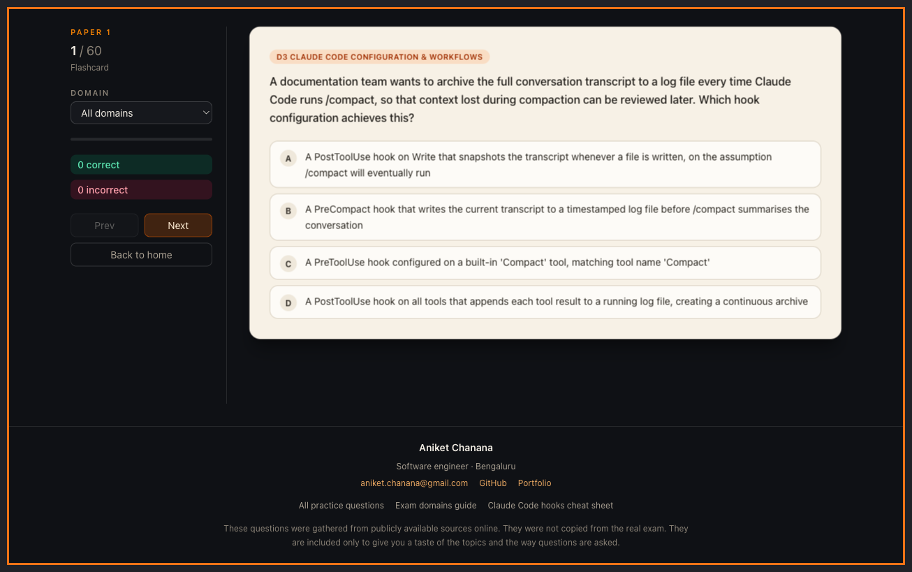

# CCARF Practice Exam — Claude Certified Architect Foundations

Free practice questions for the **Claude Certified Architect – Foundations** certification (also searched as **CCARF**, **CCAR-F**, **CCA-F**, and Anthropic Claude certification).

**Live app:** [https://aniketchanana.github.io/claudecertificationfoundation/](https://aniketchanana.github.io/claudecertificationfoundation/)

[](https://aniketchanana.github.io/claudecertificationfoundation/)

If this helps you prepare, star the repo so other learners can find it.

## What’s included

- **220+ practice questions** with per-option explanations
- **Flashcard mode** — instant feedback after each answer
- **Full exam mode** — answer everything first, unlock results at the end
- **Domain filter** — drill D1–D5 one domain at a time
- **Share score** — copy or share your exam result link
- Progress saved in `localStorage` for one active paper at a time

## Exam domains covered

| Domain | Focus |
|--------|--------|
| **D1** Agentic Architecture & Orchestration | Multi-agent design, routing, handoffs, workflows |
| **D2** Tool Design & MCP Integration | MCP tools, tool descriptions, external integrations |
| **D3** Claude Code Configuration & Workflows | Hooks, CLAUDE.md, skills, permissions, compaction |
| **D4** Prompt Engineering & Structured Output | Prompting, schemas, structured outputs |
| **D5** Context Management & Reliability | Context windows, retrieval, evals, reliability |

Study guides: [Exam domains explained](https://aniketchanana.github.io/claudecertificationfoundation/guides/ccarf-exam-domains/) · [Claude Code hooks cheat sheet](https://aniketchanana.github.io/claudecertificationfoundation/guides/claude-code-hooks/)

## Practice papers

| Paper | Description |
|-------|-------------|
| [Paper 1](https://aniketchanana.github.io/claudecertificationfoundation/papers/paper-1/) | Full practice exam · 60 questions |
| [Paper 2](https://aniketchanana.github.io/claudecertificationfoundation/papers/paper-2/) | Quick drill · 15 questions |
| [Paper 3](https://aniketchanana.github.io/claudecertificationfoundation/papers/paper-3/) | Foundations practice set · 60 questions |
| [Paper 4](https://aniketchanana.github.io/claudecertificationfoundation/papers/paper-4/) | Additional practice set · 37 questions |
| [Paper 5](https://aniketchanana.github.io/claudecertificationfoundation/papers/paper-5/) | Study-guide scenarios · 54 questions |

## Local development

```bash
npm install
npm run dev
```

## Build

```bash
npm run build
npm run preview
```

`npm run build` compiles the Vite app and generates static SEO pages (per question, domain, paper, and guides), plus `sitemap.xml` and `robots.txt`.

## Disclaimer

Unofficial study aid. Not affiliated with or endorsed by Anthropic. Exam content and branding belong to their respective owners.
